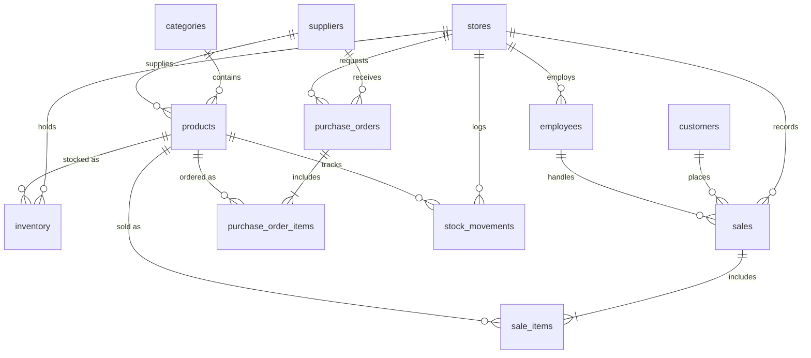

# Retail Inventory and Sales Intelligence System
**Database:** PostgreSQL (Neon) | **Schema:** `retail`

## 1. Entity Sets

| # | Entity | Purpose |
|---|--------|---------|
| 1 | categories | Product groups |
| 2 | suppliers | Vendors supplying products |
| 3 | products | Items sold, with reorder level and quantity |
| 4 | stores | Retail branches |
| 5 | inventory | Current stock of a product in a store |
| 6 | employees | Staff of each store |
| 7 | customers | Buyers (optional on a sale) |
| 8 | sales | Sale invoice header |
| 9 | sale_items | Products sold in each invoice |
| 10 | purchase_orders | Restock orders to suppliers |
| 11 | purchase_order_items | Products in each purchase order |
| 12 | stock_movements | Audit log of all stock changes |

## 2. ER Diagram

## 3. Relational Model

- **categories**(<u>category_id</u>, category_name, description)
- **suppliers**(<u>supplier_id</u>, supplier_name, contact_person, email, phone, city, lead_time_days)
- **products**(<u>product_id</u>, sku, product_name, *category_id*, *supplier_id*, unit_cost, unit_price, reorder_level, reorder_quantity, is_active, created_at)
- **stores**(<u>store_id</u>, store_name, city, address, phone)
- **inventory**(<u>*store_id*, *product_id*</u>, quantity_on_hand, last_updated)
- **employees**(<u>employee_id</u>, *store_id*, full_name, role, email, hire_date)
- **customers**(<u>customer_id</u>, full_name, email, phone, city, created_at)
- **sales**(<u>sale_id</u>, *store_id*, *customer_id*, *employee_id*, sale_date, payment_method, total_amount)
- **sale_items**(<u>sale_item_id</u>, *sale_id*, *product_id*, quantity, unit_price, discount, line_total)
- **purchase_orders**(<u>po_id</u>, *supplier_id*, *store_id*, order_date, expected_date, status)
- **purchase_order_items**(<u>po_item_id</u>, *po_id*, *product_id*, quantity, unit_cost, received_qty)
- **stock_movements**(<u>movement_id</u>, *store_id*, *product_id*, movement_type, quantity, reference, created_at)

*Underlined = primary key, italic = foreign key.*

## 4. Relationships

| Relationship | Type |
|---|---|
| categories → products | One-to-Many |
| suppliers → products | One-to-Many |
| stores ↔ products (via inventory) | Many-to-Many |
| stores → employees | One-to-Many |
| stores / customers / employees → sales | One-to-Many |
| sales ↔ products (via sale_items) | Many-to-Many |
| suppliers / stores → purchase_orders | One-to-Many |
| purchase_orders ↔ products (via purchase_order_items) | Many-to-Many |

## 5. Automation and Reports

- **Trigger `trg_sale_item_after_insert`**: each sold item reduces stock, writes a stock movement and updates the invoice total. Selling more than available stock is rejected.
- **Function `receive_purchase_order(po_id)`**: adds received goods to stock.
- **Views**
  - `v_reorder_list`: products to reorder, supplier, suggested quantity, estimated cost, priority (OUT OF STOCK / CRITICAL / REORDER)
  - `v_stock_status`: stock level and status of every product in every store
  - `v_inventory_valuation`: stock value per store
  - `v_daily_sales`, `v_monthly_revenue`, `v_product_performance`

## 6. How to Run on Neon

1. Open the Neon **SQL Editor**.
2. Paste the contents of `retail_inventory_sales_intelligence.sql` and click **Run**.
3. Test with: `SELECT * FROM retail.v_reorder_list;`
